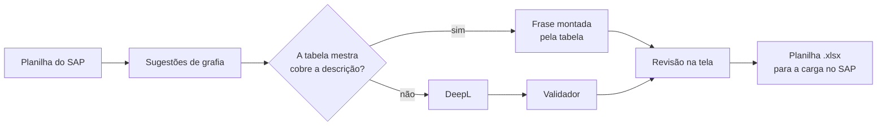

# MODALIS

Revisão e tradução de descrições de peças de vestuário: recebe a descrição em português que vem
do SAP e gera as descrições em inglês e em espanhol, com até 40 caracteres cada.

O motor de tradução é um glossário próprio, a **tabela mestra**. A API DeepL é o plano B, usada
só no que a tabela não cobre.

> **Estado:** versão 0.9.0, uso local num único computador. Piloto numa coleção real em
> dezembro de 2026. Ainda não está pronto para publicação na rede (ver [Segurança](#segurança)).

## O problema

A cada coleção, o setor de Garantia da Informação da La Moda preenche no SAP a descrição em
inglês e em espanhol de 1.000 a 2.000 peças. O campo tem limite de 40 caracteres, e a
terminologia precisa ser a mesma em todas as peças e em todas as coleções.

Um tradutor automático genérico não garante nenhuma das duas coisas: troca termos de uma peça
para outra (CINTURA MÉDIA vira MID-RISE numa e MEDIUM WAIST noutra) e não respeita o limite. O
MODALIS resolve isso montando a frase a partir de um vocabulário aprovado e de uma estrutura
fixa.

## Como funciona



1. **A tabela mestra monta a frase.** Cada termo do português tem o seu inglês e o seu
   espanhol, e pertence a uma categoria (peça, cintura, manga, tecido, detalhe…). O sistema
   encontra os termos na descrição e monta a frase numa ordem fixa. Em inglês, por exemplo, os
   adjetivos vêm antes da peça e os detalhes com `COM` viram `WITH …` no fim. O espanhol segue a
   ordem do português e faz a concordância de gênero e número.
2. **A DeepL entra só no que sobra:** descrições com palavra fora da tabela, com mais de uma
   peça ou sem peça. Na base de teste (2.464 descrições reais), isso é 7,3% do total.
3. **O validador confere a DeepL.** Se a resposta perder um termo da tabela, trouxer uma peça
   que não estava na descrição ou mudar a ordem da frase, a linha fica marcada **a revisar**.
4. **Nada é cortado.** Texto acima de 40 caracteres é marcado e corrigido por uma pessoa.

| Português | Inglês | Espanhol |
|---|---|---|
| BERMUDA JEANS COMFORT CINTURA MÉDIA | MID-RISE COMFORT JORTS | BERMUDA DENIM COMFORT TIRO MEDIO |
| SAIA JEANS MINI CINTURA BAIXA COM BRILHO | LOW-RISE DENIM MINI SKIRT WITH SHIMMER | FALDA DENIM MINI TIRO BAJO CON BRILLO |
| CALÇA PIJAMA LISTRADA | STRIPED PAJAMA PANTS | PANTALÓN PIJAMA RAYADO |

As regras completas estão em [`docs/decisoes-glossario-2026-10-22.md`](docs/decisoes-glossario-2026-10-22.md)
(inglês) e [`docs/decisoes-espanhol-2026-10-29.md`](docs/decisoes-espanhol-2026-10-29.md)
(espanhol).

### Se a DeepL falhar

A tradução continua. A linha sai montada pela tabela, com a palavra desconhecida em português,
e fica marcada como pendente para uma nova tentativa ("Traduzir pendentes"). O servidor repete
falhas passageiras, desacelera quando a DeepL pede (erro 429, comum no plano Free) e suspende
as chamadas por alguns segundos se ela parecer fora do ar, para não travar a coleção inteira.

## Funcionalidades

| Aba | O que faz |
|---|---|
| **Individual** | Traduz uma descrição para inglês e espanhol, mostra a origem de cada tradução, o contador de 40 caracteres e os termos do glossário usados. |
| **Em massa** | Importa a planilha da coleção, sugere correções de grafia, traduz só o que está pendente, permite editar e confirmar cada linha, filtra por situação e exporta a planilha final. |
| **Glossário** | Consulta da tabela mestra (835 termos em 16 categorias), com busca, filtros e exportação para Excel. Somente leitura. |

## Início rápido

**Pré-requisitos:** Node.js 22.15 ou superior e, para o plano B, uma chave da API DeepL. Sem a
chave, o sistema funciona só com a tabela.

```bash
git clone https://github.com/alexsanderantunesbarbosa/modalis.git
cd modalis
npm install
cp -n .env.example .env     # no PowerShell: if (-not (Test-Path .env)) { Copy-Item .env.example .env }
```

Preencha `DEEPL_API_KEY` no `.env` e suba a API:

```bash
npm start                   # API em http://127.0.0.1:3000
```

Depois, abra o `index.html` no navegador.

Para rodar os testes:

```bash
npm test
```

## Configuração

A configuração vem toda de variáveis de ambiente ([12-Factor](https://12factor.net/config)).
O [`.env.example`](.env.example) é a referência completa: lista cada variável com o padrão e o
motivo. As que mais importam:

| Variável | Padrão | Uso |
|---|---|---|
| `DEEPL_API_KEY` | vazia | Chave da DeepL. Nunca vai para o Git. |
| `HOST` | `127.0.0.1` | Endereço de escuta. Só este computador. |
| `PORT` | `3000` | Porta da API. |
| `MOTOR_PRINCIPAL` | `tabela` | Não mudar em uso normal. `deepl` existe só para medir a qualidade da DeepL contra a da tabela. |

As demais controlam limites de entrada e o comportamento diante de falhas da DeepL (tentativas,
tempo de espera, pausa no 429). Um número inválido volta ao padrão.

## Planilha de saída

A planilha exportada é o contrato com a transação de carga no SAP: exatamente estas 8 colunas,
nesta ordem.

| Coluna | Conteúdo |
|---|---|
| `REFERÊNCIA` | Referência da peça |
| `DESCRIÇÃO` | Descrição em português, já com as correções de grafia aceitas |
| `Descrição EN` | Descrição em inglês |
| `Descrição ES` | Descrição em espanhol |
| `TEXTO ECOM` | Cópia da `DESCRIÇÃO` |
| `Z_COMPOS_PT` / `_EN` / `_ES` | Composição da peça, como veio na planilha de entrada |

O download só é liberado sem correção de grafia pendente, sem tradução vazia e sem texto acima
de 40 caracteres. Linhas que o sistema marcou para revisão pedem uma confirmação antes de
exportar.

## Arquitetura

Aplicação sem framework. Um servidor HTTP em Node.js expõe a API, e uma tela em HTML e
JavaScript puro a consome.

| Arquivo | Responsabilidade |
|---|---|
| `tabelaMestra.js` | Tabela mestra: fonte de verdade do vocabulário PT, EN e ES |
| `processadorTexto.js` | Encontra os termos na descrição e monta a frase em inglês e em espanhol |
| `correcoesOrtograficas.js` | Sugestões de grafia |
| `server.js` | API: configuração, validação de entrada, cliente da DeepL com tentativas e disjuntor, validador |
| `index.html`, `styles.css`, `script.js` | Tela: importação, revisão e exportação |
| `estadoMassa.js` | Regras da revisão em massa, separadas da tela para serem testáveis |
| `tests/` | Testes automatizados (`node:test`) |
| `docs/` | Decisões de terminologia |

| Rota | Função |
|---|---|
| `POST /api/traduzir` | Traduz uma descrição |
| `POST /api/traduzir-massa` | Traduz uma lista de descrições |
| `POST /api/sugerir-correcoes` | Sugere correções de grafia |
| `GET /api/glossario` | Devolve a tabela mestra |

Toda resposta de tradução informa a **origem** (`tabela`, `deepl` ou `local`, que é a tabela
depois de uma falha da DeepL) e o **estado** da linha. Os logs saem em JSON, uma linha por
evento: as requisições em `stdout`, avisos e erros em `stderr`.

## Testes

`npm test` usa o runner nativo do Node e não depende de rede nem do `.env`. A DeepL é simulada
nos testes. Os testes cobrem:

- os casos de referência do inglês e do espanhol, aprovados um a um;
- as regras de concordância;
- as sugestões de grafia;
- as regras da revisão em massa;
- a API HTTP: validação, limites, novas tentativas, disjuntor e cancelamento.

Três casos do espanhol estão marcados como `todo`, porque dependem de termos ainda em
validação. Eles imprimem o erro esperado, mas não contam como falha.

## Segurança

Já existe:

- a chave só no ambiente, com o `.env` fora do Git;
- a API acessível só neste computador por padrão;
- toda entrada validada antes de chamar a DeepL;
- timeout nas chamadas;
- nenhum detalhe interno de erro enviado ao navegador;
- validação de certificados TLS ligada.

Pendências conhecidas, todas com prazo:

| Pendência | Risco | Prazo |
|---|---|---|
| CORS aberto a qualquer origem | Outra página no mesmo computador pode chamar a API | Antes do piloto: o servidor passa a servir a tela |
| SheetJS 0.18.5 carregado por CDN | Vulnerabilidades conhecidas na leitura de planilhas (CVE-2023-30533, CVE-2024-22363) | Antes do piloto: cópia local da 0.20.x |
| Sem autenticação nem HTTPS | Inaceitável fora de `127.0.0.1` | Antes de publicar na rede |

Se uma chave da DeepL vazar, revogue-a no painel da DeepL e gere outra.

## Problemas comuns

| Sintoma | Causa e solução |
|---|---|
| Na rede da empresa, toda linha que vai à DeepL sai "DeepL falhou" | A rede inspeciona o tráfego TLS. Inicie com `npm start`, que usa os certificados do Windows, e não com `node server.js`. |
| A tradução em massa parou no meio | A DeepL ficou suspensa (limite de chamadas do plano Free ou serviço fora do ar). Espere alguns minutos e clique em "Traduzir pendentes". |
| A tela não fala com a API depois de mudar `PORT` | A tela chama `localhost:3000` fixo, então mude também o `script.js`. Isso deixa de valer quando o servidor passar a servir a tela. |

## Limitações conhecidas

- A composição têxtil ainda não é traduzida.
- O trabalho na aba Em massa não é salvo: fechar a aba antes de exportar perde a revisão.
- A planilha exportada não guarda a descrição original quando uma correção é aceita.
- O glossário só é editado no código.

## Roadmap

- **Antes do piloto:** traduzir a composição, servir a tela pelo próprio servidor, SheetJS
  local, rascunho salvo no navegador, teste do contrato da planilha e CI no GitHub Actions.
- **Depois do piloto:** banco SQLite com memória de traduções aprovadas, cadastro de termos
  pela tela, glossário nativo da DeepL e publicação na rede da empresa.

## Desenvolvimento

O trabalho corre na branch `developer`. A `main` guarda a versão estável e recebe a `developer`
por merge, com tag de versão ([SemVer](https://semver.org/lang/pt-BR/)). As mensagens de commit
seguem [Conventional Commits](https://www.conventionalcommits.org/pt-br/).

## Licença

Software proprietário e confidencial, de autoria de Alexsander Antunes Barbosa, usado
internamente pela La Moda conforme acordo com o autor. Não é código aberto. Os termos estão em
[LICENSE](LICENSE).
